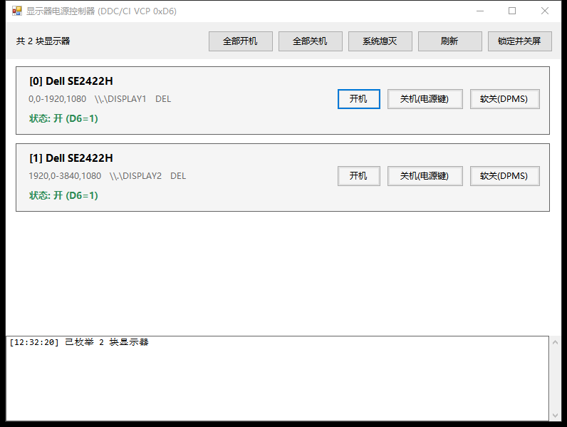
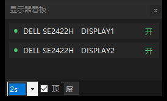

# Monitor Power · 显示器电源控制器

中文 · [English](#english)

[](LICENSE)


> 一个很小的 Windows 工具：**直接用 DDC/CI 开关物理显示器**，按「电源键」的语义把屏关掉，
> 也能一键**锁定桌面并在 1 秒后关掉显示器**。图形界面 + 命令行，单 exe，无第三方依赖。
>
> A tiny Windows app that switches **physical** monitors on/off over DDC/CI (VESA MCCS),
> with a one-click "lock the desktop, then blank the monitors" action. GUI + CLI,
> single exe, zero third-party dependencies.



状态看板（独立小窗，可置顶、可指定只看哪几块屏）：



## 项目状态

当前版本 **v1.2.1**（2026-10-23）：修复看板打开卡顿、面板用自带电源键关机再开机后一直读不到
（现在会自动重新枚举并换绑句柄）；看板行改为同时显示型号 + 接口 + 状态。
v1.2.0 增加了「关闭到托盘」与托盘菜单。最新下载见 [Releases](../../releases)。

## 为什么会有这个工具

Windows 只能通过电源计划让显示器「DPMS 熄灭」，但那只是**停止送信号**：动一下鼠标就全回来了；
系统自带的「关闭显示器」也从来不分是哪一块屏。而这个工具走的是显示器自己的控制通道
（DDC/CI 的 VCP `0xD6`），**直接问面板现在是开还是关、直接把面板关掉**，
并且可以精确到某一块屏。

## 功能

- **每块屏一张卡片**：显示型号、输出接口（`\\.\DISPLAYn`）、厂商码和实时电源状态。
- **三种关法**：
  | 按钮 | 做什么 | 和物理按键的关系 |
  |---|---|---|
  | 开机 | 写 `D6=1` | 等于按一下显示器的电源键开机 |
  | 关机(电源键) | 写 `D6=5` | 等于按电源键关机；**键鼠输入唤不醒** |
  | 软关(DPMS) | 写 `D6=4` + `SC_MONITORPOWER` | 屏幕变黑，动一下鼠标就回来 |
- **一键锁定并关屏**：锁定 Windows 桌面 → 等 1 秒 → 按**电源键语义**关闭显示器（`D6=5`，不是软关）。
  唤醒请按显示器电源键，或解锁后运行 `monitor-power.exe poweron`。
- **状态永远新鲜**：每 4 秒读一次电源状态；每 12 秒**重新枚举显示器**（换线、换口、拔插都会自动发现）；
  「刷新」按钮立即重新枚举 + 重新读取。只有显示器集合/位置/EDID 变化时才重建卡片，界面不闪。
- **DDC 不通也能好好说话**：那块屏读不到时，只在「软关」时退化为系统级熄灭；
  「关机(电源键)」不会偷换成软关，会在日志里说明原因，不假装成功。
- **型号名不依赖控制通道**：优先读 DDC 能力串里的 `model(...)`；读不到就回退到注册表里的
  **EDID**（即使这块屏完全不答 DDC/CI，也能显示正确的厂商和型号）。
- **状态看板**：独立小窗、可置顶，按你选的 1/2/5/10 秒实时刷新**指定显示器**的开关状态。
- **检查更新**：启动时后台查一次；有新版时「检查更新」旁边亮红点，点开可看说明并一键更新。
- **免安装自更新**：下载新 exe → 校验 SHA256 → 启动它替换旧文件并重启，不写注册表、不建快捷方式。
- **开机自启**：底部勾选即可（只写当前用户的 Run 键，不需要管理员）。
- **命令行**：同样的能力，带 `--json` 和退出码，方便脚本/自动化调用。
- **零第三方依赖**：单 exe，只用 Windows 自带的 .NET Framework 4.x；唯一联网动作是检查更新。

## 安装

从 [Releases](../../releases) 下载 `monitor-power.exe`，双击即可。

- 绿色单文件，**不需要安装、不需要管理员权限**（DDC/CI 以普通用户身份就能用）。
- 系统要求：Windows 10 / 11，自带 .NET Framework 4.x。
- 显示器需要在它自己的 OSD 菜单里开启 **DDC/CI**（绝大多数型号默认开启）。

## 使用

### 图形界面

双击 exe（不带参数）打开。

- **顶栏**：全部开机 / 全部关机 / 系统熄灭 / 刷新 / 锁定并关屏 / 状态看板。
- **卡片**：每块屏的 开机 / 关机(电源键) / 软关(DPMS)。
- **底部**：`v1.2.0` · 检查更新（有新版时旁边亮红点）· 开机自启 · 关闭到托盘 · ★ 给个 Star。
- **托盘**：勾选「关闭到托盘」后，点窗口的 × 只把窗口收进托盘（进程继续工作）；
  双击托盘图标回到主界面，右键菜单有 打开主界面 / 状态看板 / 全部开机 / 全部关机 / 开机自启 / 退出。
- **状态看板**：独立小窗，每行同时显示**型号 + 接口 + 状态**（如 `DELL SE2422H  DISPLAY1   开`）；
  可选 1/2/5/10 秒刷新、置顶，点「屏」勾选要显示哪几块显示器（选择保存在
  `%APPDATA%\monitor-power\board.ini`）。面板用自带电源键关掉再打开后会自动重新枚举、换绑句柄，
  不会一直卡在「读不到」。
- **底部日志**：每一步写了什么、读回什么、失败原因，都带时间戳。
- **更新**：点「检查更新」→ 有新版会显示说明 → 「立即更新」会下载、校验 SHA256、
  关闭自己、替换 exe 并重启（免安装版的自更新就是这样做的）。

### 命令行

```cmd
monitor-power.exe status                 :: 列出显示器与当前电源状态
monitor-power.exe list                   :: 只列显示器（不读 DDC）
monitor-power.exe poweron                :: 全部开机（D6=1）
monitor-power.exe poweroff               :: 全部关机（D6=5，电源键语义）
monitor-power.exe powercycle --wait 5    :: 关 → 等 5 秒 → 开 → 校验
monitor-power.exe off                    :: 软关（D6=4 + 系统级熄灭）
monitor-power.exe off --index 0          :: 只操作第 0 块屏
monitor-power.exe offddc                 :: 只写 D6=4，不做系统级熄灭
monitor-power.exe forceoff               :: 只做系统级熄灭（SC_MONITORPOWER）
monitor-power.exe lockoff                :: 锁定桌面 → 1 秒 → 关屏
monitor-power.exe --json status          :: 机器可读输出
monitor-power.exe --check-update         :: 检查更新（退出码 1 = 有更新，2 = 检查失败）
```

选项：`--index 0,1`、`--wait N`、`--force`、`--no-force`、`--json`、`--check-update`、`--version`、`--help`。

退出码：`0` 全部成功、`1` 有显示器 DDC/CI 不通（其余已尽力）、`2` 用法错误。

## 工作原理

### DDC/CI 与 VCP 0xD6

显示器通过 VESA MCCS 定义的控制码汇报/接受电源状态，这个码就是 **VCP `0xD6`**：

| 值 | 含义 |
|---|---|
| 1 | On（开） |
| 2 | Standby（待机） |
| 3 | Suspend（挂起） |
| 4 | Off (soft)（软关，等信号/输入唤醒） |
| 5 | Off (hard)（关机，等同按电源键） |

程序用 `dxva2.dll` 的 `GetVCPFeatureAndVCPFeatureReply` / `SetVCPFeature`
经显卡的 I2C 通道读写这个值；`SC_MONITORPOWER` 则通过 `WM_SYSCOMMAND` 广播给所有窗口。

### 为什么软关要补一发 SC_MONITORPOWER

只写 `D6=4` 时，只要显卡还在持续送信号，显示器一般**约 1 秒内就自己退回来了**。
所以「软关」= 写 `D6=4` + 系统级熄灭；这样面板会真正进入睡眠，直到下一次键鼠输入。

### 为什么关掉的屏需要输入才能唤醒

DPMS 熄灭的面板靠**输入事件**唤醒，这一点软件没法伪造 DDC 唤醒信号；
`D6=5`（电源键语义）则连输入都不理，只能再写一次 `D6=1` 或按物理电源键。

## 兼容性与已知限制

- **DDC/CI 在某些链路上不通**：走 VGA 再接主动转换头（HDMI/DP→VGA 这类）时，转换器通常只转发
  EDID、不转发 DDC/CI，于是「型号读得到、控制通道不通」。DVI / HDMI / DisplayPort 直连都正常；
  HDMI↔DVI 这种**被动**转接也会转发 DDC。
- **个别型号在 `D6=5` 后会切断 DDC**：那样只能按物理电源键恢复。`powercycle` 会检测并提示。
- **系统级熄灭对所有屏生效**：`SC_MONITORPOWER` 没有「只熄灭某一块」的语义，这是 Windows 的限制。
- **「全部关机」和「锁定并关屏」不会退回软关**：它们只写 `D6=5`；某块屏 DDC/CI 不通时就保持原样，
  不会用 `SC_MONITORPOWER` 代替——那是软关，动一下鼠标就全亮回来了。

## 构建

环境：Windows 10 / 11 + .NET Framework 4.x（系统自带 `csc.exe`）。

```cmd
tools\build.cmd
```

成功输出 `BUILD OK`，产物在 `dist\monitor-power.exe`。不需要 NuGet，不需要 Visual Studio。

代码约束：**C# 5 语法**（`csc.exe` 的上限），零第三方依赖，界面文案中文。

## 目录结构

```
src/monitor-power.cs     全部源码（GUI + CLI + 看板 + 更新器，单文件）
tools/build.cmd          构建脚本（先跑 make-icon，再编译）
tools/make-icon.cs       图标生成器（16/32/48/256）
docs/screenshots/        README 截图
.github/workflows/       CI 构建 + tag 自动发布（含 latest.json 更新清单）
dist/                    构建产物（不入库）
```

## 贡献

欢迎 Issue / PR。提交前请确保 `tools\build.cmd` 通过，并且**没有提交 `dist/`、个人路径或令牌**。
细节见 [CONTRIBUTING.md](CONTRIBUTING.md)。

安全问题请走 GitHub 的 Private vulnerability reporting，见 [SECURITY.md](SECURITY.md)。

## 许可

[GPL-3.0](LICENSE)。

---

## English

**Monitor Power** is a small Windows utility that switches physical monitors on and off
through DDC/CI (VESA MCCS, VCP `0xD6`), instead of the usual DPMS blanking that any mouse
movement undoes.

- Per-monitor GUI cards: **On** (`D6=1`), **Off — power button** (`D6=5`),
  **Soft off** (`D6=4` + `SC_MONITORPOWER`).
- **Lock & blank**: locks the workstation, waits one second, then blanks the monitors.
- Status is polled every 4 s; the monitor list is re-enumerated every 12 s, so a re-plugged
  cable or a new display shows up without restarting the app.
- Model names fall back to the **EDID** in the registry, so they stay correct even when a
  panel does not answer DDC/CI at all.
- CLI with JSON output: `status`, `poweron`, `poweroff`, `powercycle`, `off`, `offddc`,
  `forceoff`, `lockoff`.
- Single exe, .NET Framework 4.x only, no telemetry, no network access.

Build with `tools\build.cmd` (requires only the `csc.exe` that ships with Windows).
Requires Windows 10/11 and DDC/CI enabled in the monitor's OSD menu.
Licensed under GPL-3.0.
